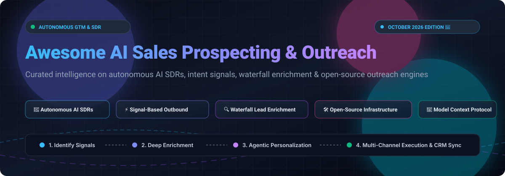

# ⚡ Awesome AI Sales Prospecting & Outreach 🎯

  

**Curated collection of autonomous AI SDRs, signal-based outbound engines, waterfall lead enrichment platforms, and open-source sales infrastructure.** 🌟 *Star if you find it helpful!* 🌟

  
  
  
  
  
  
  

  <em>Last updated: October 2026 Edition 🚀</em>

---

## 📖 Table of Contents

- [📊 Sector Overview & Market Dynamics](#-sector-overview--market-dynamics)
- [🏢 SaaS & Hosted Commercial Platforms](#-saas--hosted-commercial-platforms)
- [💻 Open-Source GitHub Projects](#-open-source-github-projects)
- [🤝 How to Contribute](#-how-to-contribute)
- [⭐ Star History](#-star-history)
- [💖 Support & Sponsorship](#-support--sponsorship)
- [⚠️ Disclaimer](#️-disclaimer)

---

## 📊 Sector Overview & Market Dynamics

The global market for AI sales assistants, autonomous AI SDRs, and sales engagement platforms (SEPs) is valued at **$3.0B–$9.2B in 2025**, rapidly expanding toward **$15B–$50B by 2030** with an accelerated compound annual growth rate (CAGR) between **16% and 44%**. 

Rather than a winner-take-all monopoly, the sector remains **highly fragmented**:
- **Enterprise Suites & Incumbents:** Giants like HubSpot, Outreach, and Salesloft dominate high-ACV enterprise pipelines by bundling deep CRM data and conversation intelligence.
- **Product-Led Intelligence Providers:** Fast-scaling leaders like Apollo.io offer massive 240M+ contact databases paired with autonomous sequences.
- **Agentic AI SDR Startups:** Autonomous digital workers (11x, Artisan) run prospecting, hyper-personalized drafting, and meeting scheduling on autopilot.
- **Open-Source & Self-Hosted Outbound:** A surging developer ecosystem provides self-hosted deliverability stacks, waterfall scrapers, and local LLM agents for complete data privacy and zero per-seat markup.

---

## 🏢 SaaS & Hosted Commercial Platforms

> [!NOTE]
> All commercial platforms are sorted in descending order by company scale (Valuation / Revenue). Pricing columns reflect transparent, non-generic starting tier figures, and free limits reflect lifetime tiers or exact evaluation trial periods.

| Platform | Starting Pricing | Free Tier / Trial Limits | Company Size (Valuation / Revenue) | Key Features & Focus |
|---|---|---|---|---|
| **[HubSpot AI Prospecting Agent](https://www.hubspot.com/)** | **$1.00/lead** recommended (requires Sales Hub Enterprise from **$150/user/mo**) | **14-day free trial** upon publishing first automated play (requires existing Sales Hub Enterprise/Pro seat); no permanent free tier for agent | **~$12.8B Market Cap** (~$3.13B+ ARR) | CRM-embedded AI agent monitoring buying signals, identifying buying committees, and drafting personalized outreach in rep voice with semi-autonomous approvals. |
| **[Outreach](https://www.outreach.ai/)** | From **~$100/user/mo** (Standard/Engage tier, billed annually; quote-based) | **No free trial or free tier**; custom enterprise sales evaluation only (guided demo / POC) | **$4.4B Valuation** (~$250M+ ARR) | Enterprise AI agent platform (Amplify Plus) orchestrating research, personalization, deal tracking, and sequences with first-party MCP support. |
| **[Salesloft](https://www.salesloft.com/)** | From **~$125/user/mo** (Advanced tier, billed annually; quote-based) | **No self-serve free trial or free tier**; requires sales qualification demo / enterprise pilot | **$2.3B Valuation** (~$450M combined ARR post-Clari merger) | Revenue orchestration platform with AI agents for account research, cadences, conversation intelligence, deal summaries, and MCP server. |
| **[Apollo.io](https://www.apollo.io/)** | **$49/user/mo** billed annually ($65 billed monthly; Basic tier) | **Free plan forever**: 75 credits/seat/mo (900 credits/yr), max 2 active sequences, 250 daily emails, 5 AI assistant chats | **$1.6B Valuation** (~$250M ARR) | 240M+ B2B contact intelligence database, intent data filters, autonomous sequences, and built-in MCP server (`mcp.apollo.io`). |
| **[11x (Alice)](https://www.11x.ai/)** | From **$3,750/mo** (Growth tier, billed annually; sales-led) | **No free trial or free tier**; sales discovery demo and negotiated enterprise POC scoping only | **~$350M Valuation** (~$10M ARR; $77M funding) | Autonomous AI SDR digital worker ("Alice" for outbound, "Julian" for inbound) executing multi-channel sequences (email, phone, LinkedIn, WhatsApp) on autopilot. |
| **[Artisan (Ava)](https://www.artisan.co/)** | **$250/mo** billed annually (Business tier) | **Free plan forever** (basic limits) + **30-day free trial with 10,000 credits** (no credit card required) | **~$250M–$350M Valuation** (~$10M ARR; $35M+ funding) | Autonomous AI BDR ("Ava") handling lead discovery (250M+ contacts), enrichment, hyper-personalized sequences, reply handling, and Claude MCP connector. |
| **[Lemlist](https://www.lemlist.com/)** | **$69/mo** (Email Pro tier, 3 sending addresses, 1,000 credits) | **14-day free trial** with 200 free credits and Multichannel Expert access (no credit card required); no permanent free tier | **$150M Valuation** (~$53M ARR; bootstrapped lempire) | Multichannel outreach (email, LinkedIn, calls) backed by 450M+ lead database, inbox rotation, custom image personalization, and lemwarm deliverability. |
| **[Amplemarket](https://www.amplemarket.com/)** | **$600/mo** billed annually (Startup plan, includes 2 user seats) | **14-day free trial** (sales-assisted onboarding / qualification); no permanent free plan | **~$50M–$100M Valuation** (~$15M–$16.6M ARR) | Consolidated all-in-one prospecting suite integrating verified lead data, intent signals, AI email drafting, and inbox deliverability warmup. |
| **[Instantly](https://instantly.ai/)** | **$47/mo** (Growth tier: 1,000 contacts, 5,000 emails/mo, unlimited warmup) | **14-day free trial** (250 contacts, 1,000 emails sending test); no permanent free plan | **Bootstrapped (~$38M–$80M ARR)** | High-volume outbound engine featuring unlimited email account connections, automated account warm-up, and add-on AI lead search/enrichment credits. |
| **[Regie.ai](https://www.regie.ai/)** | **$41–$49/mo** (Pro tier: includes 5,000 credits/mo) | **Free plan forever**: **250 one-time credits** per user (up to 10 users); no credit card required | **Series B Venture-Backed (~$8M–$15.5M ARR**; $65M+ raised) | AI prospecting platform (RegieGO) featuring credit-based autonomous research, contact enrichment, personalized drafts, and direct dialer. |

---

## 💻 Open-Source GitHub Projects

> [!TIP]
> The open-source repositories below are ranked in descending order by **GitHub Stargazers count**. Click any Stars_Badge to jump directly to the repo's stargazers community page!

1. **[eracle / OpenOutreach](https://github.com/eracle/OpenOutreach)** 
   - **Overview:** Autonomous open-source AI agent for B2B lead generation. Describe your ideal customer profile and product proposition; the agent searches the web, analyzes candidate profiles, produces an explicit rationale for why each prospect fits, and sends automated personalized outreach directly from your mailbox.
   - **Key Capabilities:** Agent-driven pipeline, zero complex manual sequence building, explainable qualification.
   - **Tech Stack:** Python.

2. **[ethanplusai / harvey](https://github.com/ethanplusai/harvey)** 
   - **Overview:** Autonomous AI sales agent engineered to run via Claude Code or OpenAI Codex. Finds prospect companies and decision-makers, crafts context-rich cold emails, executes campaigns, parses incoming replies, and books meetings on your calendar.
   - **Key Capabilities:** Runs entirely on your existing Claude/Codex credentials with no separate API keys needed, zero markup on LLM tokens.
   - **Tech Stack:** TypeScript / Node.js.

3. **[filip-michalsky / SalesGPT](https://github.com/filip-michalsky/SalesGPT)** 
   - **Overview:** Context-aware, conversation-stage sales agent built to automate cold calls and email conversations. Uses explicit stage recognition to keep conversations grounded and aligned with sales methodologies.
   - **Key Capabilities:** Stage tracking, objection handling, CRM synchronization, Twilio voice integration support.
   - **Tech Stack:** Python, LangChain, LiteLLM.

4. **[DenchHQ / DenchClaw](https://github.com/DenchHQ/DenchClaw)** 
   - **Overview:** Privacy-first, locally hosted AI CRM and prospecting engine with natural language querying over DuckDB. Discovers LinkedIn leads with customized filters, enriches emails, and drafts personalized messages.
   - **Key Capabilities:** Conversational natural language-to-SQL interface, Kanban auto-pipeline based on email replies, zero third-party cloud data persistence.
   - **Tech Stack:** OpenClaw framework, DuckDB, Python.

5. **[growthenginenowoslawski / coldoutboundskills](https://github.com/growthenginenowoslawski/coldoutboundskills)** 
   - **Overview:** Production-tested Claude Code skills for cold email deliverability, waterfall lead enrichment, campaign auditing, and outbound copywriting based on real-world multi-million email campaigns.
   - **Key Capabilities:** Lead grading, Google Maps local business scraping, Prospeo search exports, automated subject line and copy evaluation.
   - **Tech Stack:** Claude Code Skills, Markdown, Shell, Python.

6. **[kaymen99 / sales-outreach-automation-langgraph](https://github.com/kaymen99/sales-outreach-automation-langgraph)** 
   - **Overview:** End-to-end sales outreach workflow constructed on LangGraph. Coordinates multi-agent collaboration for prospect discovery, company background research, qualification scoring, and dynamic email generation synced with HubSpot and Google Sheets.
   - **Key Capabilities:** Graph-based cyclical agent workflows, stateful human-in-the-loop review, automated CRM record creation.
   - **Tech Stack:** Python, LangGraph, LangChain, Tavily Search.

7. **[asiifdev / business-leads-ai-automation (Prospex)](https://github.com/asiifdev/business-leads-ai-automation)** 
   - **Overview:** Open-source AI sales and marketing OS with mandatory human-approval outbox gates. Features lead qualification scoring, AI voice mimicking based on historical chats, and multichannel outreach across WhatsApp and Email.
   - **Key Capabilities:** Rate limiting (10/hr, 80/day caps), quiet hours, randomized send pauses, built-in STOP/opt-out compliance.
   - **Tech Stack:** Node.js, Next.js, Prisma, TailwindCSS.

8. **[adityajha2005 / yc-outreach](https://github.com/adityajha2005/yc-outreach)** 
   - **Overview:** Targeted lead scraper and cold outreach tool for Y Combinator startup founders. Select any YC batch, automatically extract founder bios and inferred corporate emails, and dispatch personalized outreach templates.
   - **Key Capabilities:** Zero dependencies outside Python stdlib + HTML UI, one-click Vercel deployment.
   - **Tech Stack:** Python, HTML/JS.

9. **[PaulleDemon / Email-automation](https://github.com/PaulleDemon/Email-automation)** 
   - **Overview:** Lightweight open-source cold email outreach and automated sequence dispatch tool designed for solo founders, marketers, and sales developers seeking reliable email scheduling.
   - **Key Capabilities:** Template variable injection, SMTP rotation, click and open rate tracking.
   - **Tech Stack:** Python, Flask, SQLite.

10. **[catin-black / meteor-emails](https://github.com/catin-black/meteor-emails)** 
    - **Overview:** Free, community-driven cold email infrastructure tool engineered to fight sales pipeline stagnation through automated list segmentation and bulk sequence sending.
    - **Key Capabilities:** Direct SMTP configuration, CSV lead list uploads, multi-account rotation.
    - **Tech Stack:** JavaScript, Node.js.

11. **[codebasics / project-genai-cold-email-generator](https://github.com/codebasics/project-genai-cold-email-generator)** 
    - **Overview:** Generative AI cold email writer leveraging open-weights Llama 3.1 LLM, LangChain, and ChromaDB vector search. Scrapes company career or service pages and produces contextually tailored cold pitches aligned with your portfolio offerings.
    - **Key Capabilities:** Career page job scraping, vector-backed portfolio matching, zero API cost when paired with local Ollama or Groq.
    - **Tech Stack:** Python, Streamlit, LangChain, ChromaDB, Groq / Llama 3.1.

12. **[AbdelftahZowail / Quickly](https://github.com/AbdelftahZowail/Quickly)** 
    - **Overview:** Self-hosted open-source cold email alternative to Instantly, Smartlead, and Lemlist. Provides sequence management, inbox warming schedules, and multi-SMTP rotation.
    - **Key Capabilities:** Deliverability monitoring, campaign scheduling, open and click webhooks.
    - **Tech Stack:** TypeScript, Next.js, PostgreSQL.

13. **[getsoyuz / soyuz](https://github.com/getsoyuz/soyuz)** 
    - **Overview:** Open-source self-hosted alternative to Apollo.io for B2B sales intelligence and sequence dispatch.
    - **Key Capabilities:** Contact list management, multi-step sequence builder, email dispatch via custom SMTP.
    - **Tech Stack:** TypeScript, Node.js.

14. **[omkarcloud / website-email-contact-scraper](https://github.com/omkarcloud/website-email-contact-scraper)** 
    - **Overview:** Fast website contact scraper that extracts corporate emails, direct phone numbers, LinkedIn/Twitter social links, and website technology stacks into structured JSON.
    - **Key Capabilities:** Headless browser crawling, regex contact validation, bulk URL queueing.
    - **Tech Stack:** Python, Playwright.

15. **[BasaltHQ / crm-official](https://github.com/BasaltHQ/crm-official)** 
    - **Overview:** AI-native CRM with built-in autonomous LeadGen Wizard agents that crawl the web, identify decision-makers, and populate pipelines with verified records.
    - **Key Capabilities:** Autonomous discovery voice AI agent (AWS Chime), multi-model LLM composer (OpenAI, Claude, DeepSeek), React Email templates.
    - **Tech Stack:** Next.js 16, React 19, Prisma, MongoDB, Vercel AI SDK.

16. **[tarinagarwal / Pigeon](https://github.com/tarinagarwal/Pigeon)** 
    - **Overview:** Comprehensive open-source cold email outreach and deliverability platform. Features mailbox warmup with threaded spam rescues, DNS automation (SPF, DKIM, DMARC), A/B testing with auto-selected winners, and Smart Leads discovery pipeline.
    - **Key Capabilities:** Multi-inbox rotation, pairing risk scoring, bring-your-own AI keys (OpenAI, Anthropic, Gemini).
    - **Tech Stack:** Next.js 16, React 19, TypeScript, FastAPI, MongoDB, Docker.

17. **[omm9846 / verdict](https://github.com/omm9846/verdict)** 
    - **Overview:** Self-hosted Apollo and Clay alternative focusing on deep email discovery and rigorous direct SMTP mailbox verification for bounce-proof sending.
    - **Key Capabilities:** ZeroBounce-style real-time MX/SMTP ping verification, waterfall lead enrichment.
    - **Tech Stack:** Go / Python.

18. **[Dvbxtreme / ai-sales-agent](https://github.com/Dvbxtreme/ai-sales-agent)** 
    - **Overview:** Open-source AI sales agent running entirely on local Ollama LLMs with zero API token costs. Combines a web scraper for discovering potential prospects with an automated email drafter.
    - **Key Capabilities:** Zero recurring API fees, local privacy, integrated admin dashboard.
    - **Tech Stack:** Next.js 15, Ollama, SQLite, JWT, TailwindCSS.

19. **[cantrip-dev / cantrip](https://github.com/cantrip-dev/cantrip)** 
    - **Overview:** Go-to-market lead discovery tool for event attendee lists and GitHub user profiles. Turns raw attendee CSVs or GitHub search queries into ranked candidate leads with tailored draft pitches.
    - **Key Capabilities:** Local web search integration (Tavily, Brave, SearXNG, Exa), rule-based or LLM-based scoring.
    - **Tech Stack:** Python 3.11+, zero external dependencies required.

---

## 🤝 How to Contribute

We welcome community contributions! Follow these steps to submit a new SaaS platform or open-source tool:

1. 🍴 **Fork** this repository.
2. 🌿 Create a feature branch: `git checkout -b add-new-sales-tool`.
3. 📝 Add your entry under either [SaaS/Hosted Platforms](#-saas--hosted-commercial-platforms) or [Open-Source GitHub Projects](#-open-source-github-projects):
   - For **SaaS**: Include verified starting tier pricing, explicit free tier/trial limits, valuation/revenue, and key features.
   - For **Open-Source**: Provide the GitHub repo link, live Stars_Badge linking to its `/stargazers` page, 1–2 sentence description, and tech stack. Maintain descending star order.
4. 🚀 Submit a **Pull Request** with a brief overview of why the tool is valuable.

---

##  Star History

---

## 💖 Support & Sponsorship

If this curated repository helped you save engineering hours, build your GTM stack, or discover open-source outbound tooling, please consider supporting the project:

- ⭐ **Star this repository** to help others discover it on GitHub.
- 🍴 **Fork and share** with your revenue engineering and sales ops peers.
- ☕ **Sponsor the Maintainer:** Support ongoing curation, benchmark updates, and new open-source projects via the [GitHub Sponsor Dashboard](https://github.com/sponsors/ishandutta2007).

---

## ⚠️ Disclaimer

- This is a community-curated directory intended for research, software architecture comparison, and educational purposes. Inclusion does not constitute an endorsement.
- Outbound sales campaigns, data harvesting, and AI-driven prospecting must strictly adhere to data privacy and anti-spam legislation across jurisdictions (e.g., GDPR, CCPA, CAN-SPAM, CASL). Always ensure proper consent mechanisms, clear opt-out options, and domain deliverability safeguards before sending live outreach.
- Vendor pricing models and free trial terms are subject to change. Always verify current commercial packages directly with respective vendors.

---

  <b>Built with care for sales engineers, autonomous agent developers, and modern revenue teams worldwide. 🚀</b>

